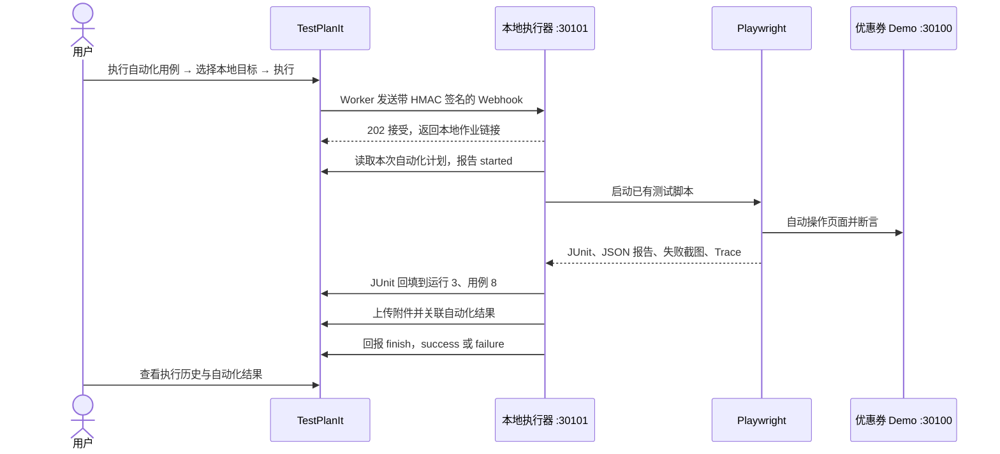

# TestPlanIt 本地按钮执行流程

验证日期：2026-10-23。TestPlanIt `v1.1.14`，项目 `2 / AIGun-测试`，测试运行 `3`，用例 `8`。

## 1. 当前已落地的流程



TestPlanIt 负责调度、管理结果；本地执行器负责启动 Node/Playwright 和回填。QuickScript 负责生成脚本，日常执行复用已保存的脚本，不在每次执行时重新生成。

## 2. 现在如何操作

1. 打开 [当前测试运行](http://localhost:30000/zh-CN/projects/runs/2/3)。
2. 点击“执行自动化用例”。
3. 目标选择“本地 Playwright｜优惠券 Demo”。
4. **分支或引用留空**：当前执行的是本机磁盘上的脚本，没有 Git 分支检出步骤。
5. 确认弹窗显示“1 个自动化用例将被请求”，点击“执行”。
6. 执行结束后查看顶部作业状态、“执行历史”，以及页面下方的“自动化结果”。失败结果内有断言详情、截图和 Trace。

本次接通了第一条用例；其他 9 条仍需手工执行。仅把其余用例勾选为“自动化”不会生成可执行脚本：还需生成、适配相应脚本并扩展本地映射。执行器发现计划包含尚不支持的用例会报错，避免静默漏跑。

## 3. 电脑重启后如何启动

先启动 Docker Desktop，再执行：

```powershell
pwsh -File C:\Users\Public\env\coupon-checkout-demo\automation\start-local.ps1
```

入口会依次启动已有 TestPlanIt 部署、优惠券 Demo 和隐藏运行的本地执行器，不重置 Demo 数据。

| 服务 | 本机地址 | 用途 |
| --- | --- | --- |
| TestPlanIt | `http://localhost:30000` | 用例、运行、调度与报告 |
| 优惠券 Demo | `http://localhost:30100` | 被测应用 |
| 本地执行器 | `http://127.0.0.1:30101/health` | 接收执行请求、启动 Playwright、回填 |

本地执行器管理：

```powershell
cd C:\Users\Public\env\coupon-checkout-demo\automation
.\manage-executor.ps1 status
.\manage-executor.ps1 logs
.\manage-executor.ps1 restart
.\manage-executor.ps1 stop
```

执行器当前已启动，但未设置开机自启动。电脑需保持运行；Docker、平台 Worker、Demo 和本地执行器都需要可用。管理脚本拒绝在本地任务执行中停止它。

## 4. 后续是否需要外部 Agent

**已有脚本的重复执行、结果回填、截图上传和作业状态回报，不需要外部 AI Agent，也不消耗 DeepSeek 调用额度。** 关闭 Codex 对话不会终止已启动的后台执行器。

新增用例时，仍然要完成“需求/用例 → QuickScript 生成草稿 → 检查及适配 → 本地验证 → 建立用例编号映射”。页面结构、业务规则、测试数据发生变化时也需要维护脚本。这些工作可由开发/测试人员完成，或借助 Agent；不要求一定使用 Agent。

当前是固定 Playwright 脚本的自动执行，不包含根据页面变化自动修复脚本。原生 AI 初稿曾有定位错误，修正记录见 `ADAPTATION.md`。

## 5. 原生能力与本地适配

| 环节 | 实现方式 |
| --- | --- |
| “执行自动化用例”按钮、执行目标、队列调度、执行历史 | TestPlanIt 原生 |
| Generic Webhook 的 HMAC 签名 | TestPlanIt 原生 |
| 读取自动化计划、报告 started / finish | TestPlanIt 原生 API |
| 启动本机 Playwright、限定支持的用例、去重 | 本次新增的本地执行器 |
| 用例结果回填 | 原生 JUnit 导入接口，本地脚本负责调用 |
| 截图和 Trace 关联 | 原生附件接口，本地脚本负责调用 |
| CI、自动提 Issue、自动关联 Issue | 本次未实现 |

执行目标 ID 为 `1`，类型 `GENERIC_WEBHOOK`，平台内配置的地址为 `http://host.docker.internal:30101/hooks/testplanit`。Docker 中的 `localhost` 指向容器自身，因此需要使用宿主机名称。

平台部署文件仅增加了 `ALLOWED_PRIVATE_HOSTS=host.docker.internal`，应用与 Worker 已重新加载。接收器绑定 `127.0.0.1`，本次实际验证了 Worker 可通过 Docker Desktop 宿主机转发访问它。没有对局域网开放新的监听地址。

签名密钥保存在 `.artifacts/executor/config.json`，该目录已被 Git 忽略；不要分享、提交或删除该文件。平台认证复用原部署文件中的正常管理员登录，不将密码/Cookie复制到报告。若管理员凭据变更，须同步原部署文件；也支持以后改用 `TESTPLANIT_API_TOKEN` 环境变量。

## 6. 本次验收

- 由浏览器页面真实点击按钮，产生平台执行编号 **1**。
- 本地任务完成，`workflowPassed: true`；作业最终为 **FAILED**。
- 自动化结果新增 **ID 3**，关联现有用例 **8**，没有新增仓库用例。
- 失败原因为预埋 Bug B1：期望折扣 `20.00`，实际 `¥0.00`；没有降低断言或修复 Demo。
- 附件为截图 **ID 7**、Trace **ID 8**；已从平台下载并与本地文件校验 SHA-256 一致。
- 测试运行仍为 **In Progress / HYBRID**，10 条用例保持不变；原手工结果 **9、10、11** 和其他 9 条用例状态保持不变。
- 无效签名、过期签名和错误项目被拒绝；同一执行编号重发不会再次执行或新增结果。

证据文件：

- `.artifacts/executor/jobs/1.json`：本地任务状态与平台终态。
- `.artifacts/executor/button-verification.json`：回读与签名/去重核验。
- `.artifacts/executor/button-target.png`：平台按钮中的本地目标。
- `.artifacts/executor/button-execution-history.png`：平台执行历史。
- `.artifacts/runs/execution-1-1792748831969/`：本次完整报告与失败证据。

## 7. 后续扩展顺序

先把其余 9 条用例逐条转成可靠脚本并完善编号映射，再验证全量执行。之后可添加独立的自动化回归运行，避免长期复用首次手工验证的记录。本次执行器为固定 PoC 范围，新增 Test Run 时须同步扩展运行选择及回填范围，不能只修改平台地址。

接入 GitLab CI 和自动提 Issue 可以在这条链路稳定后继续做；不影响当前在平台内点击执行。
